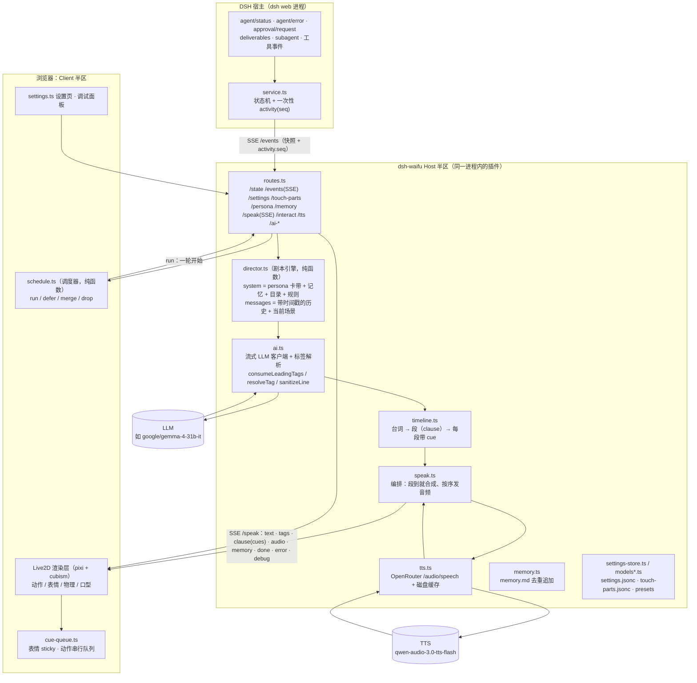

# 架构总览（2026-11-07，v1 之后）

一只 Live2D 桌宠插件，跑在 DSH Web 里。**两半进程**：Host 半区在 `dsh web` 进程内（cordis 插件），Client 半区在浏览器里（Live2D 渲染层）。
一半负责「把事实交给模型」，一半负责「把模型的演出放出来」，中间只有一条 SSE 流。

## 一张图（Mermaid）



## 时序：一次触摸

```
浏览器点中「脸·捏」
  ├─ 命中测试 → fireTrigger({kind:'tap', part:'脸', interaction:'捏'})
  ├─ schedule.ts: dispatchTrigger()  ── tap 连点窗口内 → defer（延后补发）
  │                                  └ 否则 → run
  ├─ startTurn() → POST /api/dsh-waifu/speak（SSE 响应）
Host
  ├─ director: system(persona+记忆+目录+规则) + messages(时间戳历史 + 场景)
  ├─ ai.ts → LLM 流式
  ├─ 首块标签 → consumeLeadingTags → 一轮只发一个 `tags` 帧
  ├─ 正文 → timeline.push()：说到标点即成段 → `clause {index,text,cues}`
  ├─ 每段立刻 tts.synthesize()（并行）→ 按序发 `audio {index,mime,b64}`
  ├─ 句尾 `[记] …` → 单独 `memory` 帧（Host 落盘，不进气泡/语音）
  └─ 结束 → `done {text}`
浏览器
  ├─ `clause` 到 → 文字立刻上屏（不等音频）
  ├─ `audio` 到 → 解码播放 + 口型；该段 cue 此刻执行（表情 sticky / 动作串行，队列上限 2）
  └─ `done` → 收尾：补齐没音频的段、撤 sticky、回 idle
```

## 职责边界（三个决策者，各管一段）

| 角色 | 在哪 | 决定什么 | 明确不做什么 |
|---|---|---|---|
| **调度器** `client/schedule.ts` | 浏览器 | 这次触发**要不要**发、要不要延后/合并（策略表：事件间隔、同类窗口、触摸连点、合并上限） | 不改内容、不改文案 |
| **剧本引擎** `src/director.ts` | Host | 交给模型的**输入**长什么样（人设、记忆、目录、历史、场景句） | 不持状态、不做语义判断（纯函数 + golden） |
| **演员（LLM）** | provider | 说什么、选哪个表情/动作、标签写在哪一句前面 | 不决定能不能演 |
| **编排器** `src/timeline.ts` + `speak.ts` | Host | 台词**怎么切段**、cue 归到哪一段、什么时候合成 | 不改语义、不改标签含义 |
| **播放器** `client/index.ts` + `cue-queue.ts` | 浏览器 | 什么时候**真的**演（绑定该段音频开始）、动作串行、落后就丢 | 不做语义判断 |

## Host 半区文件

| 文件 | 行数 | 职责 |
|---|---|---|
| `src/index.ts` | ~552 | 插件入口：装配 service / routes / AI / TTS / 设置，维护 aiHistory、mood 已删 |
| `src/routes.ts` | ~534 | 全部 HTTP + SSE；静态素材带 ETag/304 |
| `src/service.ts` | ~421 | DSH 事件 → 宠物状态机 + `activity {seq,kind}`；不再节流（ADR-047） |
| `src/director.ts` | ~214 | 提示词组装（system / messages / 场景句 / 目录），纯函数 |
| `src/ai.ts` | ~603 | LLM 客户端：流式解析、标签归一化、只取第一行、记忆行分离 |
| `src/timeline.ts` | ~128 | 台词 → CLI 段，cue 归属其后第一段 |
| `src/speak.ts` | ~160 | 编排：段就绪即合成、按序播、失败降级 |
| `src/tts.ts` | ~259 | TTS + 句读切分 + 磁盘缓存（200 文件上限） |
| `src/memory.ts` | ~151 | `memory.md` 追加、5 条内去重、20k 字上限 |
| `src/settings-store.ts` | ~471 | 设置读写（jsonc、ops 补丁、夹取） |
| `src/models.ts` / `models-host.ts` | 429 / 58 | 模型动作表情目录、触摸部位、preset 解析 |
| `src/time.ts` · `trace.ts` · `jsonc.ts` · `persist.ts` · `home.ts` · `clamp.ts` · `client-log.ts` | — | 时间戳 / 链路追踪 / JSONC / 原子写 / 目录解析 / 夹取 / 客户端日志 |

## Client 半区文件

| 文件 | 行数 | 职责 |
|---|---|---|
| `src/client/index.ts` | ~3757 | Live2D 层、气泡、命中测试、SSE 客户端、音频/口型、调试面板 |
| `src/client/settings.ts` | ~3045 | 设置页（显示 / 触摸部位 / AI 驱动 / 语音 / 开发者） |
| `src/client/schedule.ts` | ~183 | 触发调度器（纯函数 + 12 条假时钟测试） |
| `src/client/cue-queue.ts` | ~60 | cue 拆分、动作队列（上限 2，满了丢最旧并留痕） |
| 其它 | — | 爪印图标、命令、触摸编辑、目录预览、日志 |

## 数据文件（`$DSH_HOME/waifu/`）

| 文件 | 说明 |
|---|---|
| `settings.jsonc` | 全部设置项（ADR-013） |
| `touch-parts.jsonc` | 部位框 + 每个部位的交互（名字/触发方式/台词）+ 事件绑定 |
| `persona.md` | **用户卡带**：不自动创建，没文件就用内置默认；插件只原样放进 system 开头 |
| `memory.md` | 模型用 `[记]` 行留下的记忆，按条注入 system |
| `tts-cache/` | 音频缓存（sha1(model\|voice\|text)），最多 200 个文件 |
| `client.log` | 客户端日志（排查用） |

## 一次请求的两个窗口

- **事件窗口**（`aiMinIntervalSec`，默认 1s）：同一窗口内的事件不各发一轮，合并成一条「这期间还发生了：…」
- **同类窗口**（`activityWindowSec`，默认 10s）：同一类事件（如连续 `tool-read`）再合并
- **触摸连点窗口**（`tapGapMs`，默认 1200ms）：窗口内连点延后补发一次
- **合并上限**（`mergeMax`，默认 6）：合并队列最多留几条，超了丢最旧

## 关键 ADR

| ADR | 主题 |
|---|---|
| 033 | 首字延迟优先：不把输出改成 JSON，标签走流式 |
| 037 | AI 驱动一切：无固定台词，模型不可用就静默 |
| 043 | 调试面板里的控制台：按发生顺序记录链路 |
| 044 | 调试面板可拖动 / 缩放 / 折叠，本地记住 |
| 045 | 提示词契约（**已回退**，见 ADR-048 之后的取舍） |
| 046 | Host 只做转发（不按频率拒绝、不替角色推导状态） |
| 047 | 触发调度归一化：一个调度器 + 一张策略表 |
| 048 | 演出编排三层：剧本引擎 / 演员 / 编排器 + 播放器 |

## 不变量

1. **宿主不替模型思考**：不推导情绪档位、不按部位加权、不做语义判断（ADR-046 的教训）。
2. **人设是卡带**：插件不解析 persona 内容，也不把它复制进用户文件。
3. **一轮一个 `tags` 帧**：分块各发一次会让动作被拦腰打断（抽搐）。
4. **文字先到、声音后到**：`clause` 帧一到就上屏，音频到才播 cus。
5. **丢弃必须有痕迹**：调度器的每个 drop/defer/merge 都写进控制台。
6. **Host 改动必须重启**：cordis 的 ESM 缓存不会热换模块；客户端改动刷新页面即可。
